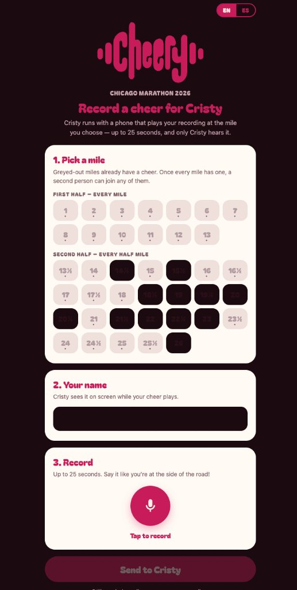
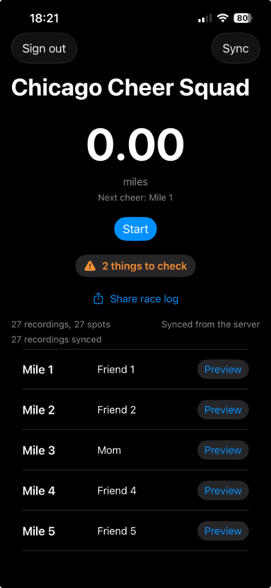
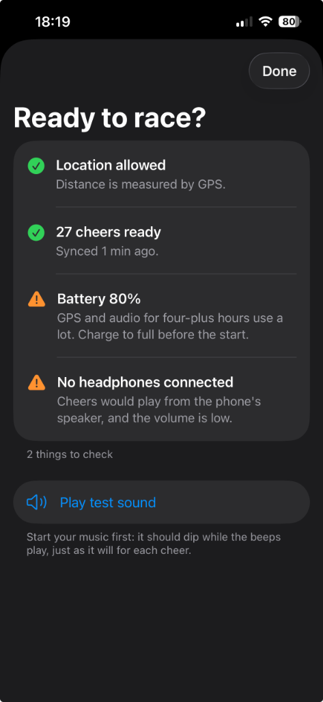

# Chicago Cheers (Cheery)

[](https://github.com/CristySolis/chicago-cheers/actions/workflows/ci.yml)

**A race-day voice-cheer system built and used for the 2026 Chicago Marathon.** Friends and family claim a mile on the course and record a 25-second cheer in English or Spanish; on race morning, the runner's iPhone syncs everything ahead of time and automatically ducks music to play each cheer offline when she reaches that mile.

<p align="center">
  
  &nbsp;&nbsp;
  
  &nbsp;&nbsp;
  
</p>

<p align="center">
  <em>Left: Supporter web recorder (EN/ES) &nbsp;·&nbsp; Center: Offline iOS race app &nbsp;·&nbsp; Right: Pre-flight readiness &amp; audio-ducking check</em>
</p>

## System Overview

```text
Supporter's phone            Backend & Storage               Runner's iPhone
─────────────────            ─────────────────               ───────────────
 sender.html ─────────────▶  FastAPI (Vercel)  ◀───────────  CheerRelay (SwiftUI)
 (pick mile, name,            ├─ Postgres (Supabase):         ├─ Pre-race Sync
  record, send)               │   events, seats, cheers       │   (manifest + WAVs
      │                       └─ Object Storage ────────────▶ │    in App Support)
      └── WAV uploads ───────────▶ (presigned PUT)            └─ Race day: offline
          straight to storage                                    GPS -> duck music -> play
```

For the full design rationale and failure-mode analysis, see **[docs/architecture.md](docs/architecture.md)**.

## Product & Engineering Decisions

- **Built around marathon psychology & UX:** Cheers occur once per mile for the first half (`1–13`) and every half mile for the second half (`13.5–26`) where runners hit the wall. Supporters see spot availability without seeing other supporters' names or recordings, and concurrent claims automatically slide forward to the next open mile with clear UI feedback.
- **Zero-signal race-day reliability:** Pre-race sync downloads WAV files into iOS `Application Support` (not `Caches`, which the OS can purge when storage is low) and drives playback from an explicit manifest. Race day makes zero network calls.
- **Pre-flight confidence before the start line:** The `Ready to race?` checklist checks location permissions, sync freshness, battery level, and headphone routing, and runs a 3-beep test through the exact audio-ducking queue used during the race.
- **Doppler-speed GPS distance over naive position deltas:** Summing GPS coordinates in dense downtown canyons (like the Loop) over-counts distance as fixes wander. `DistanceMeter` integrates Doppler speed over time with accuracy, staleness, and pace gates while requesting 10 m accuracy to preserve battery over 4.5+ hours.
- **Lock-free concurrency & serverless-friendly uploads:** Browsers upload 25 s WAV recordings straight to object storage via single-use presigned URLs (keeping audio out of Vercel serverless limits). Simultaneous mile claims resolve via a Postgres unique constraint (`one_person_per_seat`) rather than distributed locks, and Supabase's auto-REST API is closed with RLS enabled and zero policies.
- **Enforced architecture boundaries:** `import-linter` contracts in `backend/pyproject.toml` verify on every commit that core domain modules (`models`, `ports`, `allocation`, `service`) stay independent of FastAPI, HTTP, and Supabase adapters—paired with strict `mypy` and isolated unit tests for seat ranking, distance math, course spots, and readiness rules.

## Race-Day Retrospective (Chicago Marathon, Oct 2026)

Shipping this for an actual marathon surfaced a product lesson no simulator would have caught:

- **What happened:** On race morning at the start corral, cognitive load is already high (crowds, headphones, starting a GPS watch). I forgot to tap **Start** inside the iOS app at the line and triggered it ~1 km late—shifting every mile trigger slightly behind the course markers.
- **What I'd change next (V2):** Eliminate the manual start button as a single point of failure by **auto-starting from a Garmin watch activity start** or a **start-line geofence**, so the runner never has to pull out or tap their phone at the start.

## What's Where

| Folder | What it is |
|---|---|
| [`backend/`](backend/) | FastAPI API and bilingual supporter web page (`cheers/web/sender.html`). Python 3.12, Poetry. |
| [`ios-app/`](ios-app/) | `CheerRelay` SwiftUI race app and `CheerRelayTests` unit test suite. |
| [`supabase/`](supabase/) | Postgres migrations (`migrations/`) and storage configuration (`config.toml`). |
| [`docs/`](docs/) | [Architecture deep dive](docs/architecture.md) and UI screenshots. |

## Testing & CI

GitHub Actions ([`.github/workflows/ci.yml`](.github/workflows/ci.yml)) runs formatting, import-boundary enforcement, strict type checks, dependency export parity, and pure domain unit tests on every push and PR via `backend/lint.sh`.

| Suite | Command | Covers |
|---|---|---|
| Backend checks & unit tests | `cd backend && ./lint.sh` | `import-linter`, `black`, `isort`, `mypy`, `requirements.txt` sync, seat allocation rules |
| Backend integration tests | `cd backend && ./integration-tests.sh` | End-to-end API & concurrent claims against local Supabase (Docker) |
| iOS unit tests | `cd ios-app && xcodebuild test -project CheerRelay.xcodeproj -scheme CheerRelay -destination 'platform=iOS Simulator,name=iPhone 18 Pro'` | Course spots, `DistanceMeter` math, `RaceLog`, `Readiness` rules |

<details>
<summary><strong>Local Setup, Operations &amp; Deployment</strong></summary>

### Developing the backend

Needs Python 3.12, Poetry 1.8, Node (for `npx supabase`), and Docker Desktop.

```bash
cd backend && poetry install
npx supabase start # from repo root
```

From `backend/`:

| Command | Does |
|---|---|
| `./serve-local.sh` | Runs the API and sender page at `http://127.0.0.1:8000` against local Supabase. |
| `./lint.sh` | Formatting, `import-linter`, `mypy`, and fast unit tests. |
| `./integration-tests.sh` | End-to-end API tests against local Supabase. |
| `./export-requirements.sh` | Regenerates `requirements.txt` after dependency changes (used by Vercel). |

To try the sender page locally, add a row in `events` via local Supabase Studio (`http://127.0.0.1:54323`) and open `http://127.0.0.1:8000/cheer/<share_code>`.

### Building the iOS app

Open `ios-app/CheerRelay.xcodeproj` in Xcode, pick the target build configuration (**Debug** for `http://127.0.0.1:8000`, **Release** for the live API), select your device, and press **Run**.

### Managing an event (Supabase)

- **Share link:** `https://chicago-cheers.vercel.app/cheer/<share_code>` (from `events.share_code`).
- **Close submissions / change runner name:** update `submissions_open` or `runner_name` on the event's row in `events`.
- **Remove a cheer:** delete the row in `cheers` first, then the audio file in Storage (`cheers/<event_id>/`).

### Deploying

Vercel deploys `main` with `backend/` as the root directory using `DATABASE_URL`, `SUPABASE_URL`, `SUPABASE_ANON_KEY`, and `SUPABASE_SERVICE_KEY`. Apply additive migrations before merging code that depends on them:

```bash
npx supabase db push --linked
```

</details>

## License

[MIT](LICENSE)
